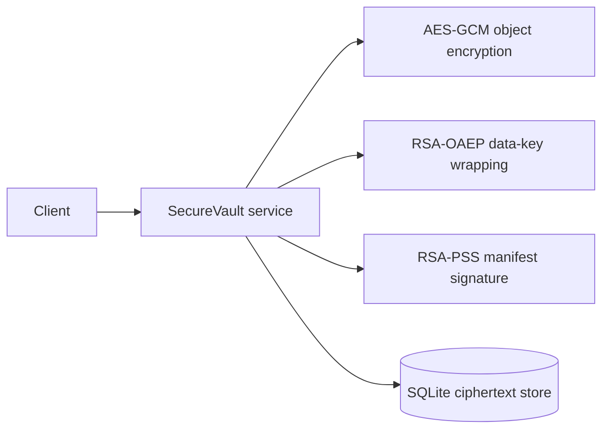

# SecureVault

SecureVault is a local encrypted document store used as the first OPMB-600 application pilot. It stores AES-256-GCM ciphertext and RSA-OAEP wrapped per-object keys in SQLite; a separate RSA-PSS key signs a canonical ciphertext manifest. Files are synthetic fixtures only.

## Workflow

The service validates basenames and size limits, binds object IDs as AEAD associated data, signs ciphertext metadata, and logs only the object ID and byte count. The application is a controlled baseline, not production storage software.

## Run

From this directory, install `requirements.txt`, then run `pytest`. Import `SecureVault` from `securevault.service`; provide the database path and recipient keys.
