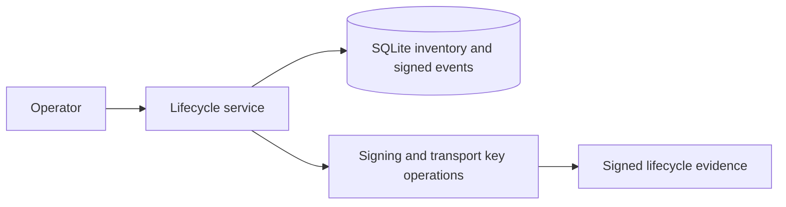

# KeyLedger

KeyLedger tracks synthetic cryptographic key ownership and purpose, stores lifecycle state in SQLite, and signs registration/rotation/revocation audit events. Recovery envelopes protect short recovery secrets for authorized custodians.

The simulation does not store private keys in its inventory database. Original RSA signing and transport keys are supplied by a caller; recovery secrets are RSA-OAEP wrapped. The reference uses ML-DSA-65 for audit signatures and ML-KEM-768 plus HKDF-SHA-256/AES-GCM for recovery envelopes.

Install `requirements.txt`; run `pytest` from this directory. All owners and secrets are synthetic.
